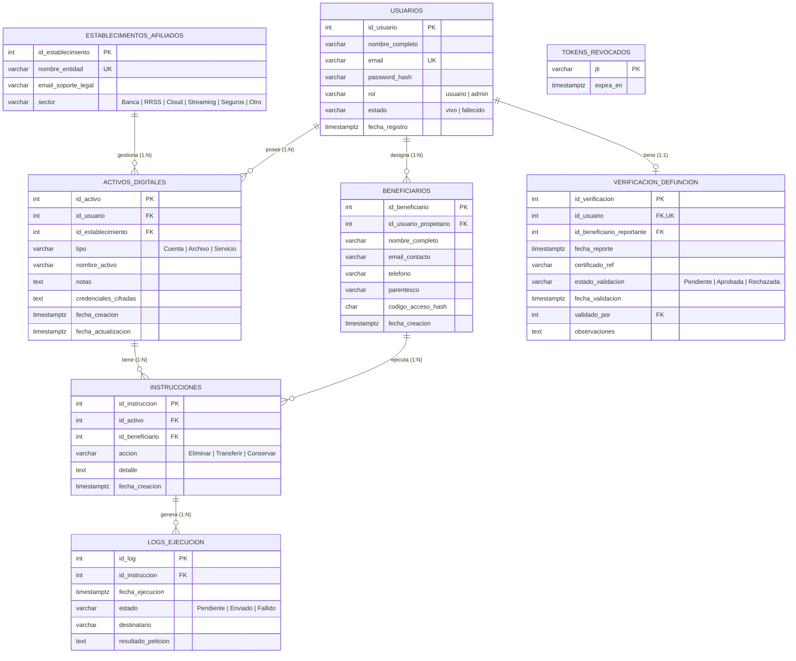

# AfterKey API 

API REST para **AfterKey**, una plataforma de gestion de herencia digital: permite a una persona registrar sus cuentas y servicios digitales, designar responsables, definir que hacer con cada activo tras su fallecimiento y, cuando el fallecimiento es verificado, notificar automaticamente a las empresas.

> Caso de estudio - Autor: Juan Pablo Arroyo Arango

abre una terminal dentro de la carpeta afterkey-api y ejecuta:


python -m venv .venv
.venv\Scripts\activate
pip install -r requirements.txt
$env:DATABASE_URL="sqlite:///afterkey.db"
flask --app wsgi init-db --seed
flask --app wsgi create-admin
flask --app wsgi run --port 8000

create-admin pide un correo, un nombre y una contraseña. Guárdalos, porque los necesitas para validar el fallecimiento.Esta opción usa SQLite para probar rápido.

Probar en Swagger (/docs)
1.POST /auth/register: crea tu usuario con “Try it out”.
2.POST /auth/login: copia el access_token de la respuesta.
3.Pulsa Authorize (arriba a la derecha), pega el token y confirma.
4.GET /establishments: verás las 14 empresas del catálogo (el id 1 es Bancolombia).
5.POST /accounts: registra una cuenta con id_establecimiento: 1.
6-POST /beneficiaries: crea un responsable y copia el codigo_acceso, porque solo se muestra una vez.
7.POST /instructions: define qué hacer con la cuenta, por ejemplo “Transferir” al responsable.

Para probar el flujo de fallecimiento:

8.POST /death-notification: en Authorize agrega X-Beneficiary-Email y X-Access-Code con los datos del responsable, y envía {"certificado_ref": "https://acta.example.com/1.pdf"}.
9-Cierra sesión del titular y haz login con el administrador. Entra a PUT /death-notification/1/validate con {"estado_validacion": "Aprobada"}.
9-Los correos a las empresas aparecen en la terminal donde corre la API, como líneas [MAIL console]. No se envían de verdad hasta que configures SMTP.
9-Consulta GET /notifications y descarga el PDF con GET /reports/history.pdf.

-----------------------------------------------


[](../../actions/workflows/tests.yml)

## Stack

| Capa | Tecnologia |
|---|---|
| API | Python 3.12 + Flask |
| Base de datos | PostgreSQL 16 (SQL puro con consultas parametrizadas, **sin ORM**) |
| Autenticacion | JWT (HS256) con revocación en logout |
| Cifrado | Fernet (AES-128-CBC + HMAC) para credenciales de activos; scrypt para contraseñas |
| Documentacion | OpenAPI 3.0 + Swagger UI en `/docs` |
| Reportes | PDF con ReportLab |
| Despliegue | Docker / Docker Compose, gunicorn |

Al no usar ORM, **todo el esquema está en scripts DDL** (`database/schema.sql`).

## Estructura

```
afterkey-api/
├── app/
│   ├── __init__.py          # fábrica de la app + comandos CLI
│   ├── config.py            # variables de entorno
│   ├── db.py                # acceso a PostgreSQL, transacción por petición
│   ├── security.py          # JWT, hashing, cifrado, control de acceso
│   ├── services.py          # lógica del envío de notificaciones
│   ├── mailer.py            # correo (console / SMTP)
│   ├── utils.py, errors.py  # validación, paginación, errores
│   └── routes/              # un blueprint por recurso
├── database/
│   ├── schema.sql           # DDL: creación de todas las tablas
│   └── seed.sql             # catálogo inicial de establecimientos
├── docs/openapi.yaml        # especificación OpenAPI
├── tests/test_api.py        # 21 pruebas de integración
├── Dockerfile · docker-compose.yml · requirements.txt · .env.example
└── wsgi.py
```

## Modelo de datos



**Tablas maestras:** `establecimientos_afiliados` (catalogo de empresas), `usuarios` y `beneficiarios`, todas con operaciones CRUD.

### Ajustes respecto al diagrama del documento

El modelo del documento se respetó entero; solo se añadieron columnas/tablas necesarias para cumplir los requerimientos:

| Adición | Motivo |
|---|---|
| `usuarios.password_hash`, `usuarios.rol` | RF-01 (login) y administración del catálogo / validación de defunciones |
| `activos_digitales.nombre_activo`, `notas`, fechas | RF-02: identificar y describir cada cuenta |
| `beneficiarios.telefono`, `parentesco`, `codigo_acceso_hash` | RF-03 (datos de contacto) y acceso seguro del responsable, que no es usuario del sistema |
| `instrucciones.detalle` y acción `Conservar` | RF-04: "instrucciones específicas" y acción *conservar* |
| `verificacion_defuncion` (reportante, validador, observaciones, fecha de validación) | RF-05: trazabilidad auditable |
| `logs_ejecucion.estado`, `destinatario` | RF-06: evidencia de envío y reintentos |
| `tokens_revocados` | `POST /auth/logout` real con JWT |

Los `ENUM` del modelo conceptual se implementan con `CHECK` sobre `VARCHAR`.

## Inicio rápido

### Opción A · Docker Compose (recomendada)

```bash
cp .env.example .env
# Edite .env y complete SECRET_KEY y CREDENTIALS_KEY (los comandos están en el archivo)
docker compose up --build
```

PostgreSQL ejecuta automáticamente `schema.sql` y `seed.sql` la primera vez. La API queda en <http://localhost:8000> y Swagger en <http://localhost:8000/docs>.

Cree un administrador (necesario para validar defunciones):

```bash
docker compose exec api flask --app wsgi create-admin
```

### Opción B · Local con PostgreSQL

```bash
python -m venv .venv && source .venv/bin/activate      # Windows: .venv\Scripts\activate
pip install -r requirements.txt

createdb afterkey                                      # o cree la BD desde pgAdmin
cp .env.example .env                                   # ajuste DATABASE_URL, SECRET_KEY...

# Crear las tablas (cualquiera de las dos formas):
psql "$DATABASE_URL" -f database/schema.sql -f database/seed.sql
#   o bien
flask --app wsgi init-db --seed

flask --app wsgi create-admin
flask --app wsgi run --port 8000
```

### Variables de entorno

| Variable | Descripción |
|---|---|
| `DATABASE_URL` | Cadena de conexión PostgreSQL |
| `SECRET_KEY` | Firma de los JWT (obligatoria en producción) |
| `CREDENTIALS_KEY` | Clave Fernet para cifrar credenciales (obligatoria en producción) |
| `JWT_EXPIRES_MINUTES` | Vida del token (por defecto 60) |
| `MAIL_BACKEND` | `console` (solo log) o `smtp` |
| `SMTP_*`, `MAIL_FROM` | Configuración del correo cuando `MAIL_BACKEND=smtp` |

## Endpoints

Documentación interactiva: **`/docs`** (Swagger UI) · especificación: `/openapi.json` · `/openapi.yaml`.

| Recurso | Endpoints | Req. |
|---|---|---|
| Autenticación | `POST /auth/register` · `POST /auth/login` · `POST /auth/logout` | RF-01 |
| Usuarios | `GET` · `PUT` · `DELETE /users/me` | RF-01 |
| Cuentas y servicios | `GET` · `POST /accounts` · `GET` · `PUT` · `DELETE /accounts/{id}` | RF-02 |
| Responsables | `GET` · `POST /beneficiaries` · `GET` · `PUT` · `DELETE /beneficiaries/{id}` · `POST /beneficiaries/{id}/regenerate-code` | RF-03 |
| Instrucciones | `GET` · `POST /instructions` · `GET` · `PUT` · `DELETE /instructions/{id}` | RF-04 |
| Establecimientos (maestra) | `GET /establishments` · `GET /establishments/{id}` · `POST` · `PUT` · `DELETE` *(escritura solo admin)* | — |
| Fallecimiento | `POST /death-notification` · `GET /death-notification/status` · `GET /death-notification` *(admin)* · `PUT /death-notification/{id}/validate` *(admin)* | RF-05 |
| Notificaciones | `POST /notifications/send` · `GET /notifications` | RF-06 |
| Reportes | `GET /reports/history` · `GET /reports/history.pdf` | RF-07 |
| Sistema | `GET /health` | — |

Convenciones: `PUT` es parcial; los listados aceptan `limit`/`offset` y devuelven `{items, total, limit, offset}`; los errores tienen la forma `{"error": {"codigo", "mensaje", "detalles"}}`.

### Flujo completo de ejemplo

```bash
API=http://localhost:8000

# 1. El titular se registra e inicia sesión
curl -s -X POST $API/auth/register -H 'Content-Type: application/json' \
  -d '{"nombre_completo":"Ana Gómez","email":"ana@example.com","password":"Clave12345"}'
TOKEN=$(curl -s -X POST $API/auth/login -H 'Content-Type: application/json' \
  -d '{"email":"ana@example.com","password":"Clave12345"}' | python -c "import sys,json;print(json.load(sys.stdin)['access_token'])")
AUTH="Authorization: Bearer $TOKEN"

# 2. Registra una cuenta (id_establecimiento 1 = Bancolombia en el seed)
curl -s -X POST $API/accounts -H "$AUTH" -H 'Content-Type: application/json' \
  -d '{"id_establecimiento":1,"tipo":"Cuenta","nombre_activo":"Cuenta de ahorros"}'

# 3. Designa un responsable  -> guarde el "codigo_acceso" (se muestra una sola vez)
curl -s -X POST $API/beneficiaries -H "$AUTH" -H 'Content-Type: application/json' \
  -d '{"nombre_completo":"Luis Gómez","email_contacto":"luis@example.com"}'

# 4. Define qué hacer con la cuenta
curl -s -X POST $API/instructions -H "$AUTH" -H 'Content-Type: application/json' \
  -d '{"id_activo":1,"id_beneficiario":1,"accion":"Transferir","detalle":"Para mi hermano"}'

# 5. Tras el fallecimiento, el responsable lo reporta (sin token: usa su correo + código)
curl -s -X POST $API/death-notification \
  -H 'X-Beneficiary-Email: luis@example.com' -H 'X-Access-Code: AK-...' \
  -H 'Content-Type: application/json' -d '{"certificado_ref":"https://.../acta.pdf"}'

# 6. Un administrador valida el documento -> se notifica automáticamente a las empresas
curl -s -X PUT $API/death-notification/1/validate -H "Authorization: Bearer $ADMIN_TOKEN" \
  -H 'Content-Type: application/json' -d '{"estado_validacion":"Aprobada"}'

# 7. El responsable consulta el historial o descarga el PDF de evidencias
curl -s $API/notifications -H 'X-Beneficiary-Email: luis@example.com' -H 'X-Access-Code: AK-...'
curl -s -o historial.pdf $API/reports/history.pdf -H 'X-Beneficiary-Email: luis@example.com' -H 'X-Access-Code: AK-...'
```

## Decisiones de seguridad

- **Contraseñas** con scrypt; el login responde igual si falla el correo o la contraseña (no revela qué usuarios existen).
- **Credenciales de activos**: opcionales, cifradas con Fernet antes de guardarse, **nunca devueltas** por la API y nunca incluidas en los correos a las empresas. Esto respeta el alcance del documento (no almacenar información sensible sin medidas).
- **Aislamiento por usuario**: cada consulta filtra por el dueño; recursos ajenos devuelven `404`.
- **Responsables sin cuenta**: se identifican con correo + código aleatorio; en la BD solo se guarda su hash SHA-256 y se puede regenerar.
- **Fallecimiento auditable**: el titular solo pasa a `fallecido` si un administrador aprueba la verificación; todo envío queda en `logs_ejecucion`, con reintentos que conservan el historial.
- **SQL parametrizado** en todas las consultas (sin concatenar datos del cliente) y validación estricta de entrada (rechaza campos desconocidos).
- **Logout real**: el `jti` del token se revoca; un titular fallecido no puede iniciar sesión.

## Pruebas

```bash
python -m unittest discover -s tests -t . -v
```

La suite (21 pruebas) cubre autenticación, CRUD de todas las entidades, aislamiento entre usuarios, cifrado en base de datos, reglas de instrucciones, permisos de administrador, el flujo completo de fallecimiento (rechazo, reintento, aprobación, envío automático, reintento de fallidos), reportes JSON/PDF y que **cada ruta esté documentada en OpenAPI**.

> Por portabilidad, las pruebas se ejecutan sobre SQLite (el DDL de PostgreSQL se traduce automáticamente en `app/db.py`). La aplicación está pensada para PostgreSQL; consulte `docker-compose.yml`.

## Alcance y limitaciones

Conforme al documento del caso de estudio, el sistema **no** realiza trámites legales de sucesión, no garantiza que las empresas acepten las solicitudes ni determina quién tiene derecho a un bien. Además:

- `certificado_ref` guarda una **referencia/URL** del acta de defunción; la carga y almacenamiento del archivo no está implementada.
- Los correos de `seed.sql` usan el dominio reservado `example.com` para no escribir a empresas reales en desarrollo; reemplácelos por los datos reales de cada entidad.
- Mejoras futuras: limitación de tasa (rate limiting) en el login, migraciones con Alembic, entrega segura de credenciales al responsable tras la aprobación.
